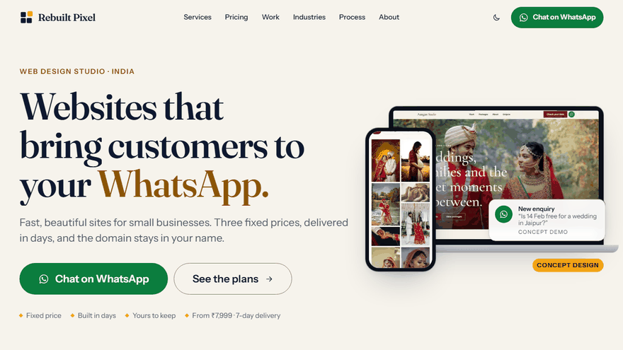
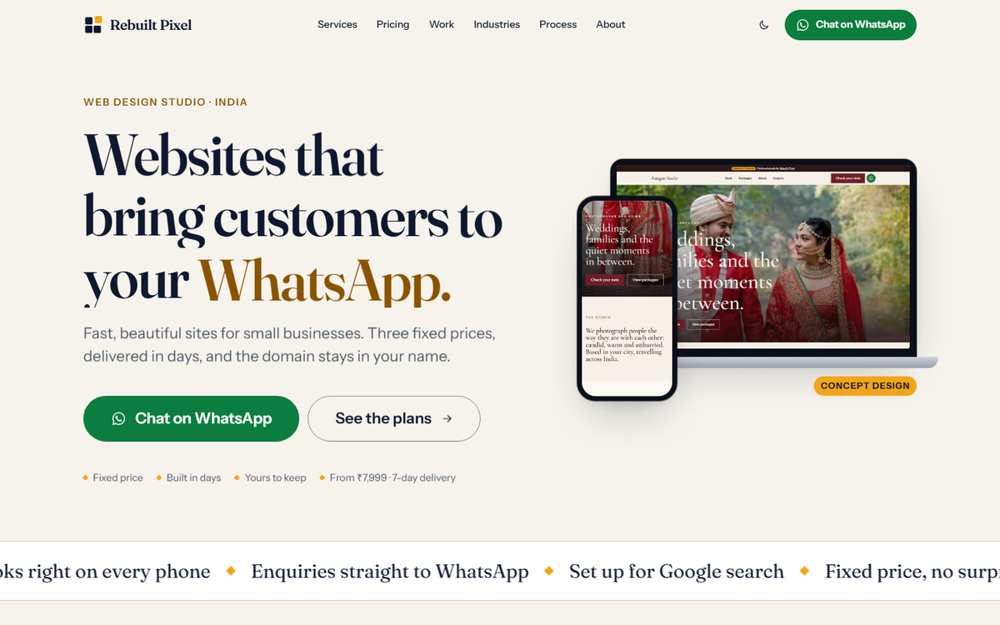
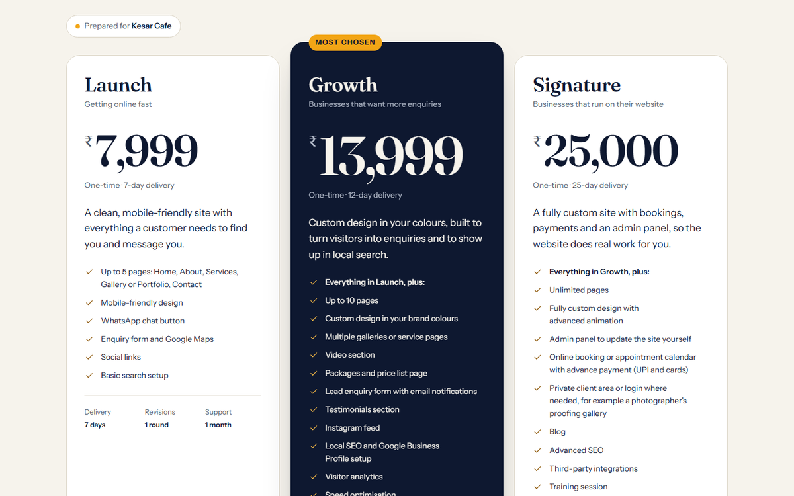
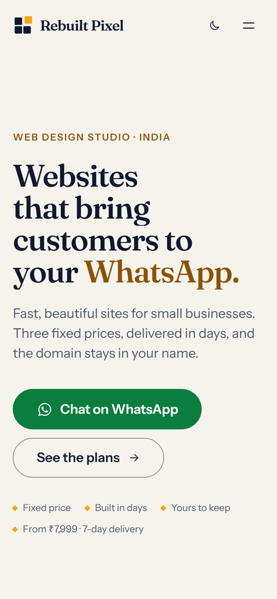
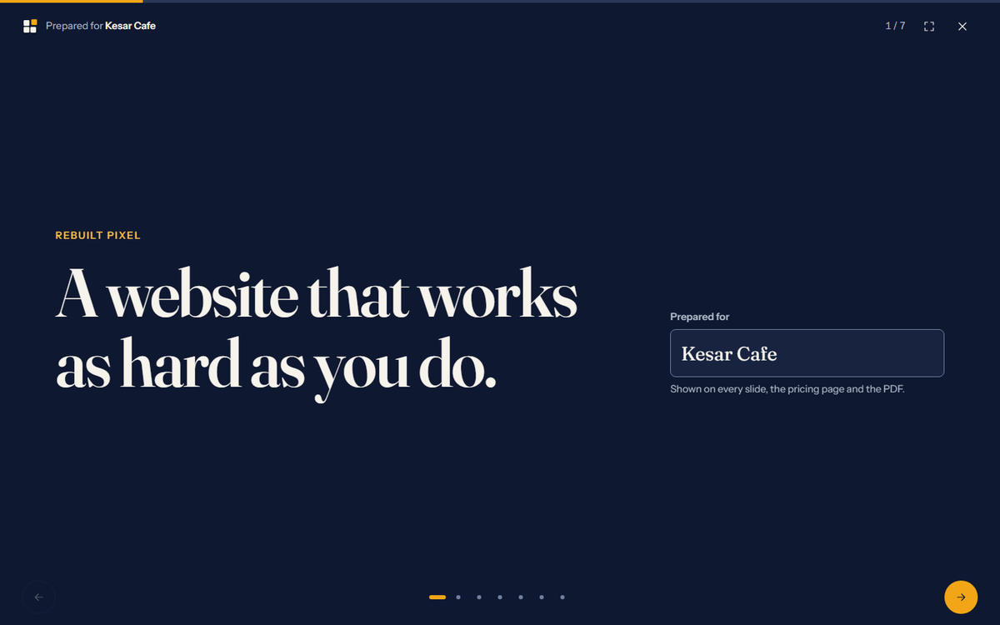
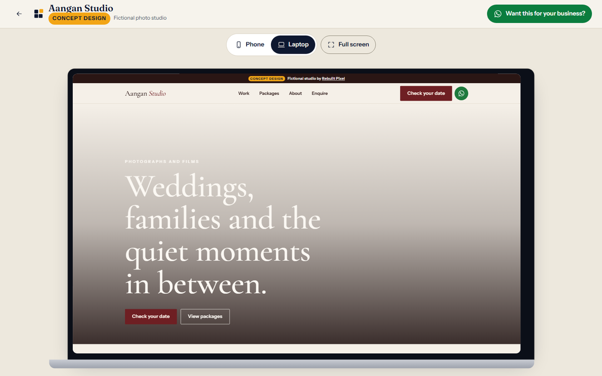

# Rebuilt Pixel

**A fast, WhatsApp-first marketing site for a fixed-price web design studio serving small businesses in India.**


<p align="center">
  
</p>

The site sells three fixed-price website plans to salons, clinics, cafés, studios and local shops. It
is built around how these customers actually buy: they search on their phone, compare prices, and
message on WhatsApp. Every page is prerendered, every price comes from one content file, and a
dedicated **Pitch mode** turns the site into a personalised slide deck for live sales meetings that
also works offline.

| Home (desktop) | Pricing | Home (mobile) |
|---|---|---|
|  |  |  |

| Pitch mode | Concept demo |
|---|---|
|  |  |

*All images are captured from the production build running locally (`next start`) with Playwright.*

---

## Features

- **WhatsApp-first enquiries:** every call to action opens WhatsApp with a pre-filled message that names the plan or page the visitor came from. A short enquiry form is the fallback.
- **Fixed-price plans from one source of truth:** prices live in `src/content/plans.ts` and flow into the cards, comparison table, Pitch mode, the downloadable PDF, WhatsApp messages and Google structured data.
- **Pitch mode (`/pitch?client=Name`):** a keyboard- and swipe-driven slide deck personalised with the client's name, with QR codes and a generated PDF of the plans. A service worker caches it so it works without a connection.
- **Touchable concept demo (`/demo/studio`):** a complete example site for a fictional photo studio, shown in a phone or laptop frame with a filterable gallery and lightbox.
- **Industry landing pages:** for example `/for/photographers`, with tailored copy and Open Graph images.
- **Production-grade enquiry API:** server-side validation, a honeypot, per-IP rate limiting, and delivery by email (Resend) and/or a JSON webhook (for example a Google Sheet).
- **SEO and sharing:** sitemap, robots, canonical URLs, generated Open Graph and Twitter images, and JSON-LD for the business, services and FAQ.
- **Privacy-respecting analytics:** cookieless options (Vercel Analytics, Plausible) by default. Google Analytics and Meta Pixel load only after consent.
- **Accessible by design:** WCAG AA colour contrast checked in code, 44 px touch targets, keyboard support and reduced-motion handling.

## Tech stack

| Area | Choice |
|---|---|
| Framework | Next.js 16 (App Router, static prerendering, route handlers) |
| UI | React 19, TypeScript, Tailwind CSS 4, design tokens in `src/styles/tokens/` |
| Motion | GSAP, Lenis smooth scrolling (disabled under reduced motion) |
| Documents | pdf-lib (plan PDF), qrcode (QR codes) |
| Email and leads | Resend API, optional webhook |
| Quality | ESLint, TypeScript, custom contrast checker, Playwright end-to-end checks, Lighthouse, axe-core |
| CI and hosting | GitHub Actions, Vercel |

## How it works

1. **Content is data.** All copy, plans, services, industries, FAQs and Pitch slides live in `src/content/`. Components only render it, so editing a price or headline never touches layout code.
2. **Static first.** Marketing pages are prerendered at build time. The only dynamic route is `POST /api/enquiry`.
3. **Enquiry pipeline.** The API validates input against a shared schema (`src/lib/enquiry-schema.ts`), returns `422` with field errors on bad input, silently accepts and drops honeypot submissions, and allows 5 requests per IP every 10 minutes before returning `429`. A lead is then sent by Resend, by webhook, or both. In production the API returns `503` if no delivery method is configured, so leads are never lost silently.
4. **Offline Pitch mode.** `public/sw.js` pre-caches Pitch mode and the concept demo, including images, so a sales meeting does not depend on venue Wi-Fi. Uncached pages show an offline fallback.
5. **Personalisation.** The `client` query parameter is sanitised (`src/lib/client-name.ts`) and appears on every slide, in the pricing page, and in the filename of the generated PDF.

## Project structure

```
src/
  app/            routes: (site) for the marketing site, (bare) for /pitch and /demo, api/enquiry
  components/     layout, sections, ui, forms, pitch, demo, motion
  content/        all copy, prices and plans (edit these, not the components)
  lib/            WhatsApp links, formatting, metadata, structured data, PDF, QR, validation
  styles/tokens/  colour, type, space and motion tokens
public/sw.js      service worker (offline Pitch mode and demo)
scripts/          contrast check, Playwright QA, screenshots, Lighthouse, icon generation
docs/             research, design system, decisions, launch guide, to-do list
```

## Installation

Requires Node.js 20.9 or newer (tested with Node.js 22).

```bash
git clone https://github.com/Ronitjaiswal1/rebuilt-pixel.git
cd rebuilt-pixel
npm install
cp .env.example .env.local     # optional for local development
npm run dev                    # http://localhost:3000
```

Production build:

```bash
npm run build
npm start
```

The enquiry form works locally without any keys: leads are printed in the terminal. In production it
needs `RESEND_API_KEY` and/or `LEAD_WEBHOOK_URL`; see [`.env.example`](.env.example) and [docs/LAUNCH.md](docs/LAUNCH.md).

## Usage

- **Change prices or copy:** edit the files in `src/content/`. For example, set `price: 13999` in `plans.ts`; the site formats it as ₹13,999 everywhere.
- **Set contact details:** fill in the WhatsApp number, email and city in `src/content/site.ts`. Until then the related UI is hidden instead of showing placeholder data.
- **Run a sales meeting:** open `/pitch?client=Kesar Cafe`. Use the arrow keys, Space, Home and End to move, and F for full screen.
- **Show the concept demo:** open `/demo/studio` and switch between phone and laptop frames.
- **See the design system:** open `/styleguide` (hidden from search engines).

## Testing and quality checks

```bash
npm run check            # ESLint + TypeScript + WCAG colour-contrast check
npm run build && LEAD_WEBHOOK_URL=http://localhost:3999/hook npm start -- -p 3100
npm run qa:e2e           # 37 Playwright functional checks (runs a mock webhook on :3999)
npm run qa:screens       # every page at 390/768/1440 px, light and dark, with overflow detection
npm run qa:lighthouse    # Lighthouse, mobile and desktop
```

`npm run check` and `npm run build` also run in GitHub Actions on every push.

## Results

Measured on 2026-11-16 against the production build on a local machine.

**End-to-end checks:** 37 of 37 pass, covering touch-target size, reduced motion, Pitch navigation by keyboard and swipe, PDF download, lightbox and gallery filters, form validation, lead delivery to a webhook, honeypot, rate limiting, offline Pitch mode, and a crawl confirming every internal link and asset resolves.

**Lighthouse (median of 3 mobile runs, single desktop run):**

| Page | Mobile performance | Desktop performance | Accessibility | Best practices | SEO |
|---|---:|---:|---:|---:|---:|
| `/` | 92 | 100 | 100 | 100 | 100 |
| `/pricing` | 96 | 100 | 100 | 100 | 100 |
| `/services` | 96 | 100 | 100 | 100 | 100 |
| `/contact` | 95 | 100 | 100 | 100 | 100 |
| `/for/photographers` | 97 | 100 | 100 | 100 | 100 |
| `/pitch` | 97 | 100 | 100 | 100 | 66* |
| `/demo/studio/site` | 86 | 99 | 100 | 100 | 69* |

\* Pitch mode and the concept demo are deliberately excluded from search engines (`noindex`), which Lighthouse scores as an SEO issue.

Cumulative Layout Shift is 0 on every page. All colour pairs in the design system pass WCAG AA ([docs/CONTRAST.md](docs/CONTRAST.md)).

## Future work

- Fill in real contact details, domain and social links before launch (tracked in [docs/TODO.md](docs/TODO.md)).
- Replace the concept demo with case studies from real client projects.
- Serve smaller responsive images on the concept demo to lift its mobile score.
- Move the in-memory rate limiter to a shared store (for example Upstash Redis) for multi-instance hosting.
- Add a Hindi version of the key pages.

## Author

**Ronit Jaiswal**

## License

The source code is released under the [MIT License](LICENSE). The Rebuilt Pixel name and logo are not
covered by the license. Photographs are used under the terms listed on the `/credits` page.
